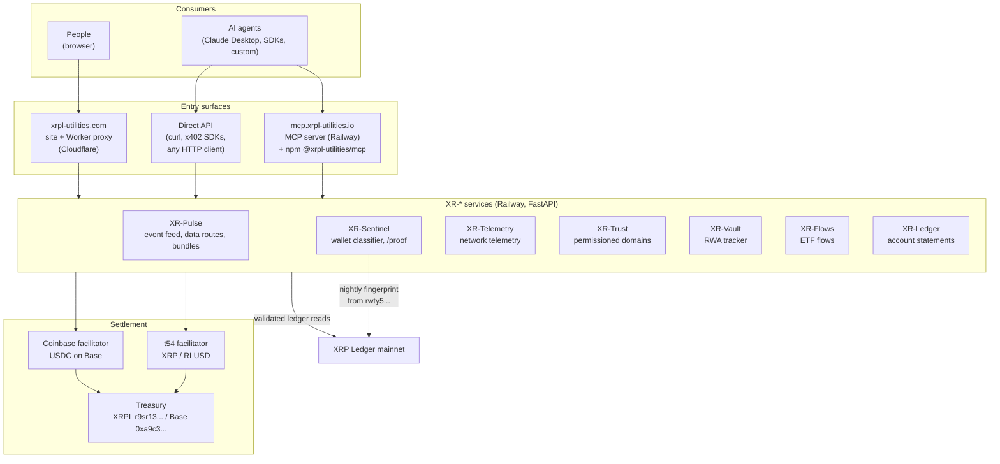

# XRPL-Utilities portfolio architecture

Seven live services on the `xrpl-utilities.io` domain, this MCP server, and a
marketing and data site on `xrpl-utilities.com`. Every paid call is settled
over x402: XRP or RLUSD on XRPL mainnet through the [t54](https://t54.ai)
facilitator, or USDC on Base mainnet through the Coinbase facilitator. All
revenue lands on one XRPL treasury (`r9sr13PJ4u6ZvmkCWEQCs5AEenBo4zU3xF`) and
one Base address (`0xa9c371e166229AAaA4C3999FB8a203e43c7329F8`).

## High-level flow



### Entry surfaces

| Surface | Audience | Auth model |
|---|---|---|
| `xrpl-utilities.com` | People browsing the portfolio | Free on the site through a short-lived visitor pass |
| `mcp.xrpl-utilities.io` | AI agents using MCP clients | Stateless passthrough; caller supplies its own x402 payment |
| `npm @xrpl-utilities/mcp` | AI agents running MCP locally via stdio | Same as above; runs on the user's machine |
| Direct API (`*.xrpl-utilities.io`) | Custom integrations | Native x402 |

### Prices

| Tier | Price | Examples |
|---|---|---|
| Data calls | $0.01 | Pulse market views, Telemetry series, Trust activity and jurisdictions, Vault daily-flow history, Flows correlation, Desk briefing |
| Deep dives | $0.10 | Sentinel scan and history, Pulse event queries, Telemetry snapshot, Trust domains, Vault and Flows scans, Ledger statement |
| Bundles | $0.05 to $0.25 | XRP market briefing $0.05; fund flow, permissioned venue and network snapshot $0.10; RWA token report $0.15; wallet check $0.25 |
| Stream | $0.50 / $2.50 / $7.50 | Pulse live stream, 1h / 6h / 24h |

Each tool's description and each 402 challenge carry the exact price.

### Inter-service edges

| From | To | Purpose | Auth |
|---|---|---|---|
| Vault | Pulse `/stats/rwa-summary` | Issuer and AMM pool state | sister key |
| Flows | Pulse, Telemetry | Exchange flow for the ETF correlation | sister key |
| Telemetry | Flows, Vault | ETF holdings and RWA flow history | sister key |
| Pulse | Sentinel | Classify whale senders and receivers | sister key |
| Pulse bundles | Sentinel, Ledger, Trust, Telemetry, Flows | One answer built from several services | sister keys |

### Discovery surfaces

Every service exposes `/agents.json` (also at `/.well-known/agents.json`),
`/.well-known/x402`, `/llms.txt`, `/schema`, `/openapi.json`, `/healthz` and
`/uptime`. Each repo has a pre-commit hook that blocks a manifest change
without a matching `schema_version` bump, and this server's
`knownSchemaVersions` must list every live version.

### Payment flow

```
Agent --signed payment as PAYMENT-SIGNATURE--> MCP server
                                                  |
                                                  | forwards verbatim
                                                  v
                                             Backend service
                                                  |
                                                  | verify (t54 or Coinbase)
                                                  v
                                             Backend runs the work
                                                  |
                                                  | settle on XRPL or Base
                                                  v
                                             Answer + PAYMENT-RESPONSE,
                                             with a provenance block
```

A failed answer is never settled, so the caller is not charged for it.

### Verified Record

- Every 200 answer on a paid route carries a `provenance` block: service,
  `schema_version`, `served_at` and the newest validated XRP Ledger the
  service had read (`index`, `hash`, `close_time`).
- Each evening XR-Sentinel saves a fixed set of published figures, builds a
  SHA3-512 Merkle root and writes it in a memo from
  `rwty5XRq5zrqTZ7XMLgk3EqQ76V3SY8Gwy`. `GET https://sentinel.xrpl-utilities.io/proof`
  lists the days; https://xrpl-utilities.com/verify/ checks one in the browser.

The MCP server holds no wallets, takes no cut and runs no proprietary logic.
It is a transparent proxy; revenue flow is identical to direct API users.
